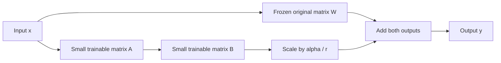

# LoRA basics: how a base model is customized

Start here for the idea, then inspect [Demoscener's actual
adapters](demoscener/lora-and-training.md). You do not need to understand every
transformer detail before understanding what LoRA changes.

## 1. What are we changing when we train a model?

A language model contains learned numbers called **parameters** or **weights**.
It uses them to transform input tokens into scores for the next token. Training
measures an error or reward-related loss and adjusts trainable parameters using
gradients and an optimizer. Inference uses the resulting parameters to generate
outputs, without updating them.

A **base model** means the starting pretrained model, not a single layer at the
bottom of the network. It contains many layers. Demoscener starts from the
Qwen2.5-Coder-7B Base model and applies LoRA to selected operations throughout its
28 transformer blocks. It does not just customize one "base layer."

One common operation inside a layer is a matrix multiplication. A matrix is a
rectangular table of numbers; multiplying it by an input vector produces another
vector. Think of it as a learned transformation of the information flowing
through the model:

```text
input x → weight matrix W → output y = W x
```

Full fine-tuning can adjust all the selected original weights. Saving a separate
fully fine-tuned 7B model for every specialty is expensive.

## 2. LoRA adds a small trainable adjustment

**LoRA** means **Low-Rank Adaptation**. Keep the original matrix `W` frozen and
learn two smaller matrices, `A` and `B`, whose product provides an adjustment:

```text
W_effective = W + s × B A
y           = W x + s × B(A x)
```

`s` is a scaling factor. With standard LoRA it is `lora_alpha / r`.



The extra branch changes the layer's computation even though `W` itself stays
unchanged. Gradients train `A` and `B`; the frozen base still participates in
forward computation. This is the central idea of the
[LoRA paper](https://arxiv.org/abs/2106.09685).

## 3. Why are two matrices cheaper than one?

Suppose `W` has 4,096 rows and 4,096 columns. It contains:

```text
full matrix: 4,096 × 4,096 = 16,777,216 parameters
```

Choose rank `r = 8`. The update uses:

```text
A:     8 × 4,096 = 32,768 parameters
B: 4,096 ×     8 = 32,768 parameters
total:             65,536 parameters
```

That is 256 times fewer trainable parameters for this matrix. The full original
matrix still exists; the saving is in the **trainable adjustment**, not removal of
the base model.

"Low rank" means information in the adjustment passes through a small `r`-wide
intermediate representation. `B A` cannot represent every arbitrary change to
`W`. It is a constrained way to adapt the model, which can still change behavior
substantially. Higher rank increases capacity and parameter cost; it is not an
automatic quality improvement. See [PEFT's LoRA
overview](https://huggingface.co/docs/peft/main/en/conceptual_guides/lora).

## 4. A tiny numerical example

Ignore scaling for a moment (`s = 1`) and use:

```text
W = [2  0]    x = [3]    A = [1  -1]    B = [0.5]
    [0  1]        [4]                      [1.0]

base output:       W x     = [6, 4]
small bottleneck:  A x     = [3 - 4] = [-1]
adjustment:        B(A x)  = [-0.5, -1]
adapted output:             [5.5, 3]
```

Check each multiplication yourself. The output changed while the four numbers
in `W` stayed fixed. This 2×2 toy illustrates the arithmetic; at this tiny size,
the two update matrices do not save parameters. The large example above does.

At standard PEFT initialization, `B` starts at zero, so the new adapter initially
adds zero. Its behavior changes after training learns nonzero adjustments.
[PEFT initialization documentation](https://huggingface.co/docs/peft/main/en/conceptual_guides/lora#initialization-options)

## 5. What do the common settings mean?

| Setting | Meaning | Demoscener's saved value |
| --- | --- | --- |
| `r` | Width of the low-rank bottleneck | 16 |
| `lora_alpha` | Controls update scaling; standard scale is alpha/r | 32, giving scale 2 |
| `target_modules` | Which matrix operations receive LoRA branches | Attention and feed-forward projections |
| `lora_dropout` | Training-time dropout on the adapter input | 0 |
| `bias` | Whether extra bias parameters are trained | `none` |

Rank is not the number of layers or generated responses. Alpha is not the
optimizer's learning rate. Choosing target modules determines **where** adaptation
can happen; the loss and training data determine **what** it learns.
[PEFT configuration reference](https://huggingface.co/docs/peft/main/package_reference/lora)

## 6. LoRA is a training method that combines with different objectives

LoRA is a **parameter-efficient fine-tuning method**. It determines which
parameters learn and constrains their updates while training happens. Saving an
adapter afterward preserves those learned updates; saving is not what makes it
LoRA. It does not ordinarily train the full model first and then extract a small
record of arbitrary changes.

The names below describe different aspects of training, not mutually exclusive
alternatives. See [training basics](training-basics.md) for CPT versus SFT and
the role of curriculum.

| Choice | Question it answers | Examples |
| --- | --- | --- |
| Data and objective | What examples and feedback drive learning? | CPT on raw code; SFT on desired responses; GRPO rewards |
| Curriculum | How does example selection change over time? | Increasingly favor popular programs; introduce harder tasks |
| Parameter-update method | Which numbers learn and how are updates represented? | Full fine-tuning; LoRA A/B matrices |
| Inference decoding | How do fixed weights produce an output? | Greedy decoding, temperature-based sampling |

You can train LoRA using a next-token loss or an RL objective. LoRA is not itself
a kind of reward, an RL algorithm, a prompt, or a source of randomness.

This is why Demoscener can publish LoRA adapters for **CPT**, **curriculum**, and
**GRPO**. These are checkpoint labels in a training progression. The curriculum
stage continues next-token learning while changing example sampling; curriculum
is not inherently SFT, and it can also accompany RL. All three published stages
use LoRA to represent learned adjustments.
Compare with [the shared RL notes](reinforcement-learning-basics.md#lora-and-the-learning-signal).

## 7. Training, loading, switching, and merging

| Operation | What changes? |
| --- | --- |
| Create an adapter | Add A/B matrices; this alone does not teach the task |
| Train an adapter | Update its trainable matrices using a loss and optimizer |
| Save an adapter | Write its learned matrices and configuration |
| Load an adapter | Reconstruct its branches and read existing learned values |
| Switch adapters | Use a different learned adjustment on the same base |
| Change prefix/temperature/seed | Change input or token selection; weights stay fixed |
| Merge an adapter | Form effective weights from `W + sBA` for deployment |

A LoRA checkpoint usually needs the compatible base model as well as its own
weights. In PEFT, `adapter_config.json` describes the setup and
`adapter_model.safetensors` stores learned tensors. It is not a self-contained 7B
model. [PEFT checkpoint format](https://huggingface.co/docs/peft/main/en/developer_guides/checkpoint)

We keep Demoscener adapters separate so we can switch stages and disable them for
a base comparison. Merging creates an effective weight matrix in memory; it does
not rewrite your downloaded base files unless you explicitly save a new model.
Only one of these independently loadable stage adapters is active at a time.

## 8. LoRA vs QLoRA, and what memory it saves

Ordinary LoRA freezes base weights. **QLoRA** additionally uses a quantized base,
commonly a 4-bit representation, while training adapters. Quantization stores
numbers more compactly and introduces approximation; it is a separate choice
from the low-rank update. [QLoRA paper](https://arxiv.org/abs/2305.14314)

LoRA reduces trainable weights, gradient storage, and optimizer state. The base
still needs to be loaded and evaluated; training also needs activations and other
working memory. A 160 MB adapter does not make the entire 7B model fit in 160 MB,
and a 100× parameter reduction does not imply 100× faster inference.

## 9. Practice with the real example

1. Calculate parameter counts for a 4,096×4,096 matrix at ranks 4, 8, and 16.
   What doubles as rank doubles, and what stays fixed?
2. Work through the tiny numeric example. What happens if `B` is all zeros?
3. Read [Demoscener's concrete matrix shapes](demoscener/lora-and-training.md#what-is-inside-the-downloaded-adapters).
   Explain why its query projection has two matrices and what each dimension means.
4. Run its metadata inspector. Distinguish adapter size, base size, and the number
   of parameters we would train when adapting with this configuration.
5. Compare stages with fixed prefix and decoding. Then fix the stage and change
   sampling. Which experiment changes learned parameters in use, and which does not?
6. Explain why selecting your favorite animation is feedback but not yet training.
   What additional steps would make it an RL update?

Continue with [Demoscener's LoRA and training case study](demoscener/lora-and-training.md)
or return to [the learning index](README.md).
